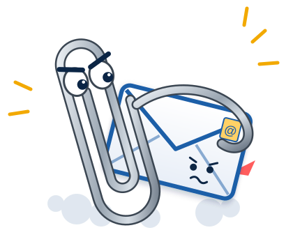

<p align="center">
  
</p>

<h1 align="center">Clippy's Revenge</h1>

<p align="center"><b>Your classic Outlook, as a local MCP server for Claude Code. No cloud, no Graph, no OAuth.</b></p>

<p align="center">
  <a href="https://github.com/dirkpetersen/clippys-revenge/actions/workflows/ci.yml"></a>
  <a href="https://github.com/dirkpetersen/clippys-revenge/releases/latest"></a>
  <a href="https://github.com/dirkpetersen/clippys-revenge/releases"></a>
  <a href="https://dirkpetersen.github.io/clippys-revenge/"></a>
  <a href="LICENSE"></a>
  <br>
  
  
  
  
  
  <br>
  
  
  
  <a href="https://github.com/dirkpetersen/clippys-revenge/commits/main"></a>
</p>

---

A fast Outlook MCP server that works without the cloud. It is a Windows tray
app that drives your **classic Outlook** desktop client through COM, keeps a
local full-text index of your mail, and exposes search, drafts, calendar and
free/busy to Claude Code (including Claude Code running in WSL) over
`http://127.0.0.1:<port>/mcp`.

No Microsoft Graph, no Entra app registration, no OAuth. If Outlook can open
it, Clippy can use it. `SPEC.md` is the source of truth for behavior.
User documentation: <https://dirkpetersen.github.io/clippys-revenge/>.

## Install

Requirements: Windows 11 with classic Outlook (not the new Outlook), signed in.
An Exchange / Microsoft 365 mailbox is required (IMAP/POP-only profiles aren't supported).

Paste this into PowerShell (no admin needed):

```powershell
irm https://github.com/dirkpetersen/clippys-revenge/releases/latest/download/install.ps1 | iex
```

It downloads the latest release, checks `ClippysRevenge.exe` against the
release's `SHA256SUMS.txt`, installs it and starts it. Run the same line
again to update.

<details>
<summary>Other ways to install</summary>

Preview what it would do, without changing anything:

```powershell
& ([scriptblock]::Create((irm https://github.com/dirkpetersen/clippys-revenge/releases/latest/download/install.ps1))) -WhatIf
```

Or download `install.ps1` from the
[latest release](https://github.com/dirkpetersen/clippys-revenge/releases/latest) and run it:

```powershell
.\install.ps1                                # same as the one-liner
.\install.ps1 -Source .\ClippysRevenge.exe   # install a local build instead
```

</details>

This copies `ClippysRevenge.exe` to `%LOCALAPPDATA%\Programs\ClippysRevenge\`,
creates a Start menu shortcut and starts the app. You can also just download
`ClippysRevenge.exe` from the release and run it. The exe is not code-signed
yet, so SmartScreen warns on first launch.

Uninstall:

```powershell
& ([scriptblock]::Create((irm https://github.com/dirkpetersen/clippys-revenge/releases/latest/download/install.ps1))) -Uninstall
```

It stops the app and removes the exe,
the shortcut and the "Start with Windows" entry, then asks whether to delete
your settings, token, index and logs. Add `-Purge` to delete them without
asking.

## First run

1. The app creates its data folders, an auth token and default settings, and
   registers itself to start with Windows.
2. Right-click the paperclip in the tray and choose **Copy "claude mcp add"
   command**. It copies:
   ```
   claude mcp add --scope user --transport http clippy http://127.0.0.1:8765/mcp --header "Authorization: Bearer <token>"
   ```
3. Paste it in a terminal where Claude Code runs (Windows or WSL).

Clippy attaches to a running Outlook and never starts it by itself. If
Outlook isn't running, indexing waits. The tray's **Start Outlook** item
(shown only then) is the one place that starts it. Other tray items: Sync
now, Pause indexing, Rebuild index, Shared mailboxes, Activity, Settings,
Open log folder, Open data folder.

## WSL setup

In WSL2's default NAT mode, WSL cannot reach the Windows host's `127.0.0.1`.
Use mirrored networking (Windows 11 22H2 or later). In
`%USERPROFILE%\.wslconfig`:

```ini
[wsl2]
networkingMode=mirrored
```

Then run `wsl --shutdown` in Windows and reopen your WSL shell. Check from
WSL:

```bash
curl -i -X POST http://127.0.0.1:8765/mcp     # expect: 401 Unauthorized
```

The app listens on `127.0.0.1` only. It does not bind to the WSL virtual
adapter, and there is no WSL interop dependency: WSL talks to it over TCP.

## Tools

Tool names are snake_case. `mailbox` is optional (empty = your own mailbox, or
a configured shared mailbox's address; search tools also accept `all`).

| Tool | What it does |
|---|---|
| `search_emails` | Full-text and filtered search over the local index (sender, recipient, subject, folder, dates, attachments, unread, mailbox), newest first |
| `get_message` | Full message by id, fetched live from Outlook |
| `get_attachment` | Saves one attachment to a permitted folder, returns its path |
| `save_attachments` | Saves the attachments of all messages matching a search |
| `create_draft` | Saves a new draft (never sends), with signature and attachments |
| `reply_draft` | Saves a reply or reply-all draft (never sends) |
| `list_events` | Calendar events in a date range |
| `find_free_times` | Free/busy based meeting slot suggestions for you and others |
| `send_meeting_invite` | Creates a meeting. The only sending tool; see below |
| `index_status` | Index size, sync state and last sync time per mailbox |

## Security model

- **Localhost only.** Kestrel binds `127.0.0.1` and nothing else.
- **Bearer token.** Every request needs `Authorization: Bearer <token>`,
  compared in constant time. The token is stored DPAPI-encrypted for your
  Windows user (`%APPDATA%\ClippysRevenge\token.bin`), never in
  `settings.json` and never in logs. Regenerate it from the tray any time.
- **Browsers are blocked.** Any request with an `Origin` header gets a 401,
  so web pages cannot call the server. The 401 has no `WWW-Authenticate`
  header, so MCP clients don't start OAuth.
- **No sending of mail.** Tools only ever save drafts. The one exception is
  `send_meeting_invite`, which sends only after you click Send in a
  confirmation dialog (mode `Send`), or just saves a draft (`DraftOnly`), or
  is off (`Disabled`).
- **Attachments' content is never indexed.** Only file names are stored.
- **File access is restricted by `PathPolicy`.** Every path a tool reads or
  writes must be inside an allowed folder: the attachment folder
  (`%USERPROFILE%\Downloads\Clippy's Revenge` by default, always allowed) and
  `%USERPROFILE%\Documents`, plus whatever you add in Settings. `..`, UNC,
  `\\?\`, alternate data streams and junction escapes are refused. This blocks
  prompt-injected writes to places like Startup folders.

### Index at rest

The index is one SQLite database per mailbox under `%LOCALAPPDATA%\ClippysRevenge\`
(`index.db`, and `index-<smtp>.db` for shared mailboxes). It holds message
bodies in plain text, like Outlook's own OST cache. It is protected by your
user profile's ACLs and by disk encryption: **turn on BitLocker**. There is
no extra encryption layer.

| What | Where |
|---|---|
| Settings, token | `%APPDATA%\ClippysRevenge\` |
| Index, logs (7 days) | `%LOCALAPPDATA%\ClippysRevenge\` |
| Attachment exports | `%USERPROFILE%\Downloads\Clippy's Revenge` |

## Shared mailboxes

Mailboxes mounted in your Outlook profile appear under tray menu **Shared
mailboxes**. Checking one starts indexing it into its own index file;
unchecking asks whether to delete that index. Tools reach it with
`mailbox="helpdesk@example.edu"`, or search all of them with `mailbox="all"`.

## Troubleshooting

- **"Outlook is not running"** in the tray: start classic Outlook (or use the
  tray's **Start Outlook**). Indexing resumes by itself.
- **Outlook is open but Clippy says it isn't running**: run both at the same
  elevation (neither as administrator). It must be classic Outlook, not "new
  Outlook". After an Outlook restart, click into the Outlook window and then
  another window, or wait a minute; otherwise restart Outlook. Clippy
  re-attaches by itself.
- **Outlook not responding** (a dialog is open, or it is busy): Clippy times
  out COM calls instead of hanging; close the dialog and retry.
- **401 from curl or Claude**: wrong or regenerated token. Copy the command
  from the tray again. Check the port in Settings → Connection too.
- **WSL can't connect**: check `.wslconfig` mirrored networking and that you
  ran `wsl --shutdown`.
- **Logs:** tray → **Open log folder** (`%LOCALAPPDATA%\ClippysRevenge\logs`).

## Build from source

```bash
dotnet build -c Release
dotnet test -c Release --filter "live!=outlook&live!=claude"      # what CI runs
dotnet test tests/ClippysRevenge.Core.Tests          # Core only (also works in WSL)
dotnet publish src/ClippysRevenge.App -c Release -r win-x64 --self-contained \
  -p:PublishSingleFile=true -p:IncludeNativeLibrariesForSelfExtract=true -o publish
```

Live Outlook tests (`[Trait("live","outlook")]`) touch your real mailbox and
run only with `CLIPPY_LIVE=1`. See `CLAUDE.md` for the project rules.

## License

See `LICENSE`.
