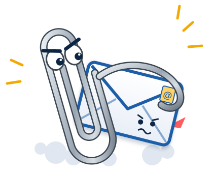

# Clippy's Revenge

{ width="280" }

Clippy's Revenge is a Windows tray app that lets Claude Code work with your
**classic Outlook**. It runs a small MCP server on your own PC, talks to
Outlook through COM, and keeps a local full-text index of your mail so searches
are fast.

You can ask Claude things like "find the invoice Ann sent last month", "save the
PDFs from that thread", "draft a reply", "who emails me the most?" or "find a time
next week when the five of us are free".

## Why use it

- **No cloud.** It uses the Outlook that is already signed in on your PC. There
  is no Microsoft Graph, no Entra app registration and no OAuth.
- **Fast search.** Mail is indexed locally with SQLite full-text search, so
  Claude can search tens of thousands of emails without waiting for Outlook.
- **Works from WSL.** Claude Code on Windows or in WSL connects over
  `http://127.0.0.1:<port>/mcp`.
- **You stay in control.** See the promises below.

## What it can do

- **Search and read mail.** Full-text and filtered search over the local index, full
  messages fetched live from Outlook, and attachments saved to a folder you allow.
  Attachment contents are never indexed. See [Tools](tools.md) and
  [Indexing](indexing.md).
- **Count and analyze.** `email_stats` counts mail by sender, domain, folder, month,
  weekday or hour, and `query_index` runs a read-only `SELECT` over the index. They
  return counts and names, not mail text.
- **Write drafts.** New mail and replies are saved as drafts in Outlook, with your
  signature and attachments. Clippy never sends them.
- **Find meeting times.** `find_free_times` ranks free slots from everyone's calendar
  and gives ready-to-paste options, with the time in CET for senders in Europe. See
  [Calendar](calendar.md).
- **Prepare meetings.** `create_meeting_draft` saves a meeting unsent in your calendar.
  The tray lists your **Draft invites** and shows a yellow badge until you send them.
- **Shared mailboxes.** Index and use shared mailboxes from your Outlook profile.
- **AI drafts (optional, off by default).** Clippy asks Claude to write reply drafts to
  new mail in your own style, using your Claude Code or an Anthropic API key. The
  default model is the latest Opus. When an email asks for a meeting, the draft offers
  free times from your calendar. When a thread moves on, Clippy re-checks its own
  unedited drafts and replaces them or moves them to Deleted Items. **Rescan emails from
  the last 24 hours** drafts replies for the last day of mail on demand. See
  [AI drafts](ai-drafts.md).
- **Tray, Settings and Activity.** One menu for everything, a settings window and an
  activity log of what Clippy did. See [Tray menu](tray.md), [Settings](settings.md) and
  [Activity](activity.md).
- **Updates itself.** Once a week, with a checksum check and automatic rollback, or only
  when you say so. See [Updates](updates.md).

## Safety promises

!!! success "What Clippy will not do"
    - It **never sends anything.** New mail and replies are saved as drafts, and
      meetings are saved unsent in your calendar. You review and send them from
      Outlook.
    - It **never deletes your email**, and never empties Deleted Items. It doesn't
      move your mail either. The one exception is Clippy's own outdated AI drafts:
      an unedited AI draft that a newer message in the thread made obsolete is moved to
      **Deleted Items**, where you can still get it back. Drafts you edited, opened or
      sent are never touched. See [Outdated drafts](ai-drafts.md#outdated-drafts).
    - It **never starts Outlook by itself.** Only the tray's **Start Outlook**
      item does, when you click it.
    - It listens on **127.0.0.1 only**, and every request needs a secret token.
    - Attachment **contents are never indexed**, only file names.
    - It **never reads your Claude login.** AI drafts run your own `claude` command or
      use an API key you type in.

See the [security model](security.md) for details.

## Where to go next

1. [Install](install.md) with one line of PowerShell.
2. [Connect Claude Code](connect.md) by pasting one command.
3. Browse the [tools reference](tools.md) to see what Claude can do.
4. Look through the [tray menu](tray.md) and [Settings](settings.md).

## What you need

- Windows 11
- Classic Outlook (the one that opens `OUTLOOK.EXE`, not "new Outlook")
- An Exchange or Microsoft 365 mailbox. IMAP/POP-only profiles are not supported.
- Claude Code, on Windows or in WSL
