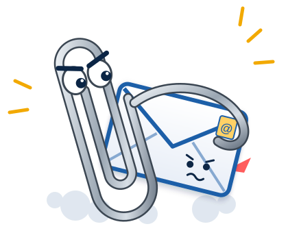

# Clippy's Revenge

{ width="280" }

Clippy's Revenge is a Windows tray app that lets Claude Code work with your
**classic Outlook**. It runs a small MCP server on your own PC, talks to
Outlook through COM, and keeps a local full-text index of your mail so searches
are fast.

You can ask Claude things like "find the invoice Ann sent last month", "save the
PDFs from that thread", "draft a reply", or "find a time next week when the five
of us are free".

## Why use it

- **No cloud.** It uses the Outlook that is already signed in on your PC. There
  is no Microsoft Graph, no Entra app registration and no OAuth.
- **Fast search.** Mail is indexed locally with SQLite full-text search, so
  Claude can search tens of thousands of emails without waiting for Outlook.
- **Works from WSL.** Claude Code on Windows or in WSL connects over
  `http://127.0.0.1:<port>/mcp`.
- **You stay in control.** See the promises below.

## Safety promises

!!! success "What Clippy will not do"
    - It **never sends anything.** New mail and replies are saved as drafts, and
      meetings are saved unsent in your calendar. You review and send them from
      Outlook.
    - It **never deletes or moves your email.**
    - It **never starts Outlook by itself.** Only the tray's **Start Outlook**
      item does, when you click it.
    - It listens on **127.0.0.1 only**, and every request needs a secret token.
    - Attachment **contents are never indexed**, only file names.

See the [security model](security.md) for details.

## Where to go next

1. [Install](install.md) with one line of PowerShell.
2. [Connect Claude Code](connect.md) by pasting one command.
3. Browse the [tools reference](tools.md) to see what Claude can do.

## What you need

- Windows 11
- Classic Outlook (the one that opens `OUTLOOK.EXE`, not "new Outlook")
- An Exchange or Microsoft 365 mailbox. IMAP/POP-only profiles are not supported.
- Claude Code, on Windows or in WSL
